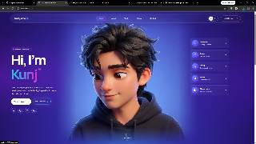

# Kunj.exe — Portfolio + Avatar Turntable

A React + Vite portfolio page with a five-second neon logo intro, glass-style navigation, avatar hero, with cursor-tracked 360° avatar video scrubbing in the hero.

## Start the site

From this project folder, run:

```bash
npm install
npm run dev
```

Open the local URL printed by Vite (usually http://localhost:5173). Vite refreshes the page when source files change.

## Customize the page

- `public/avatar-portrait.png` — front-facing portrait and video poster.
- `public/videos/avatar-turntable.mp4` — avatar video used in the hero and the Work scrubber.
- `src/App.jsx` — intro timing, hero copy, nav, interests, and cursor scrubbing.
- `src/styles.css` — neon intro animation, glass portfolio styling, and responsive layout.

To reduce motion, enable your device's **Reduce Motion** accessibility setting; the intro will be skipped. Visitors can also skip it or replay it from the hero.

For smoother frame-by-frame scrubbing, encode the video at a constant frame rate with a short keyframe interval (about 0.1–0.25 seconds). All-intra encoding is smoothest but creates a much larger file.
"# test-cursor" 

## Preview

| Character reference | Portfolio preview |
| --- | --- |
|  |  |
